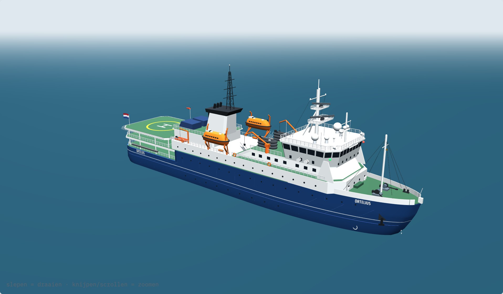

# Ortelius RC

RC-model van het Nederlandse poolexpeditieschip **Ortelius** van Oceanwide
Expeditions (thuishaven Vlissingen), op schaal 1:100.

**Status:** vormstudie v2 in de browser. Brug, dekken, ramen, achterschip,
schoorsteen en davits zijn verfijnd op basis van de 17 lokale foto’s.
Eerst deze vorm beoordelen; de printbare CAD-versie volgt daarna.

Open [`index.html`](index.html) voor het draaibare 3D-model met zes vaste
aanzichten en onderdelenlijst. Het model begint stil. Met **Water** uit
zie je ook het geschatte onderwaterschip.

| Bestand | Inhoud |
|---|---|
| [`START-HIER.md`](START-HIER.md) | Actuele status, werkvolgorde en overdracht |
| [`ONTWERP.md`](ONTWERP.md) | Alle maten, assenstelsel, printopdeling, open punten, uitleg van `index.html` |
| [`ONDERDELEN.md`](ONDERDELEN.md) | Afvinkbare onderdelenlijst |
| [`referentie/README.md`](referentie/README.md) | Uitleg bij de 17 lokale foto’s in `images/` (buiten Git) |
| `beelden/render.jpg` | Browserweergave van de huidige vormstudie |
| `cad/`, `print/` | CAD-bronnen en printbestanden (nog leeg) |

## Origineel

| | Echt schip | Model 1:100 |
|---|---|---|
| Lengte | 91 m | 91 cm |
| Breedte | 17,2 m | 17,2 cm |
| Diepgang | 5,4 m | 5,4 cm |
| Waterverplaatsing | ca. 4.090 t | ca. 4 kg |

Gebouwd in 1989 in Gdynia (Polen) als *Marina Svetaeva*, ijsklasse 1A,
helikopterdek en hangar toegevoegd in 2007.

## Ontwerpkeuzes

- Voorstel: romp in vier delen van 22,75 cm voor de Bambu Lab P2S.
  Deelvlakken en afneembare bovenbouw zijn nu alleen visueel getoond;
  verbindingen en magneten moeten nog in CAD worden uitgewerkt.
- Eén schroef en één roer zoals het origineel, plus een boegschroef voor
  wendbaarheid.
- Kenmerken uit de foto's: hoge voorromp met beplatingsvlakken en open achterdekken, witte
  hoekige schoorsteen met zwarte vakwerkmast, grote oranje geknikte davits, laag
  helidek achter op kolommen, groene dekken.
- Logo's van de rederij zijn bewust neutraal gehouden.

## Bronnen

- [MV Ortelius – Wikipedia](https://en.wikipedia.org/wiki/MV_Ortelius)
- [15 Features, Figures, and Facts About Ortelius – Oceanwide Expeditions](https://oceanwide-expeditions.com/blog/15-features-figures-and-facts-about-ortelius)
- [Where is the helicopter deck located – Oceanwide Expeditions](https://oceanwide-expeditions.com/faq/where-is-the-helicopter-deck-located)

## Volgende stappen

1. Vormstudie v2 beoordelen vanuit zijaanzichten, boeg, achterschip en bovenaanzicht.
2. Daarna romp en bovenbouw in CAD uitwerken met wanddikte, naden en uitlijning.
3. Concreet gekozen RC-techniek inpassen en gewicht/stabiliteit berekenen.
4. Proefprint en slicercontrole, daarna waterdichtheid en vaargedrag testen.

De hoofdmaten komen uit de bronnen hierboven. Dekhoogtes, posities en
onderwatervorm zijn fotogebaseerde schattingen; dit model is geen lijnenplan
en nog geen gevalideerd print- of vaarmodel.
