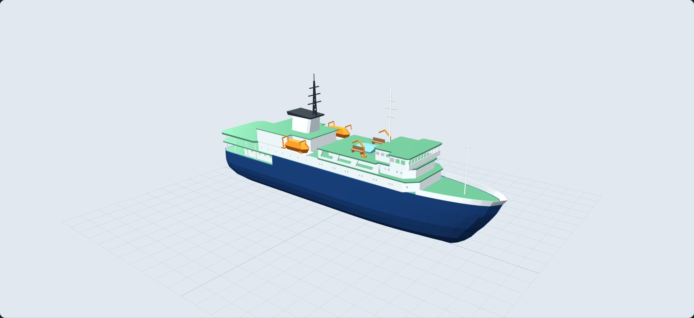

# Ortelius RC

RC-model van het Nederlandse poolexpeditieschip **Ortelius** van Oceanwide
Expeditions (thuishaven Vlissingen), op schaal 1:100.

**Status: CAD- en printprototype p1 beschikbaar.** De holle romp bestaat uit
vier delen; de vooropbouw is afneembaar. Er zijn losse bovenbouwdelen,
RC-montageplaten, twee helikopters, proefstukken en een bouwbeschrijving.

- [Bekijk de daadwerkelijke CAD-onderdelen](cad/index.html), ook uit elkaar.
- [Open de CAD-assemblage (STEP)](cad/step/ortelius-p1-assemblage.step).
- [Begin met de bouw- en printvolgorde](print/BOUWHANDLEIDING.md) en de [onderdelenlijst](print/onderdelen.csv).
- Parametrische bron: [`cad/build.py`](cad/build.py) en [`cad/parameters.json`](cad/parameters.json).

Dit is het eerste constructieprototype. Digitale geometrie- en slicercontrole
staan in `print/`; fysieke passing, lekdichtheid en vaargedrag moeten nog
worden getest. De RC-hardware is nog niet definitief gekozen. Kleine
modelbouwdetails en schilderwerk zijn geen volledige kopie van de browserstudie.

Open [`index.html`](index.html) voor het draaibare model. Naast de zes
overzichtsaanzichten zijn er detailknoppen voor **Middenschip**, **Helikopter** en **Hangar**.
Het model begint stil. Met **Water** uit zie je het geschatte onderwaterschip.

[Onderdelen uit elkaar bekijken](beelden/cad-p1-exploded.jpg) · [Oorspronkelijke vormstudie v3](beelden/render.jpg)

| Bestand | Inhoud |
|---|---|
| [`START-HIER.md`](START-HIER.md) | Actuele status en werkvolgorde |
| [`ONTWERP.md`](ONTWERP.md) | Maten, fotokoppeling, aannames en bronfuncties |
| [`ONDERDELEN.md`](ONDERDELEN.md) | Voorlopige onderdelenlijst voor de latere RC-uitwerking |
| [`referentie/README.md`](referentie/README.md) | Overzicht van 34 lokale beeldbestanden in `images/` (buiten Git) |
| [`beelden/render.jpg`](beelden/render.jpg) | Browserweergave van het hele model |
| [`beelden/middenschip-v3.jpg`](beelden/middenschip-v3.jpg) | Detail van de open galerijen en dekuitrusting |
| [`beelden/hangar-v3.jpg`](beelden/hangar-v3.jpg) | Detail van de open hangar |
| [`beelden/helikopter-detail.jpg`](beelden/helikopter-detail.jpg) | Gele helikopter op het helidek |
| [`cad/index.html`](cad/index.html), [`cad/README.md`](cad/README.md) | Printgeometrie bekijken, bewerkbare bron en STEP |
| [`print/README.md`](print/README.md), [`print/BOUWHANDLEIDING.md`](print/BOUWHANDLEIDING.md) | STL/3MF, aantallen, controle en bouwvolgorde |

## Twee gele helikopters

Twee neutrale modellen met gele romp, cockpitramen, staartboom, stabilisator,
landingsski's en rotoren. Ze zijn geïnspireerd op de lokale foto's en de
AS350/H125-vorm; de exacte vliegtuigvariant op de foto's is niet bevestigd.
De hoofdmaten volgen de [Airbus-maattekening](https://www.airbus.com/sites/g/files/jlcbta136/files/2025-01/master-ground-rescue-booklet-h125.pdf):
romplengte 10,93 cm, stabilisatorbreedte 2,53 cm en rotor Ø 10,69 cm op 1:100.
De gekozen modelhoogte is circa 3,14 cm.

Normaal staat één toestel op het helidek en hangt het andere naast het schip.
**Helikopter** zoomt in op het toestel op het dek. Met **Heli’s in hangar**
worden ze naast elkaar gestald en worden de hoofdrotorbladen apart in rekken
gelegd. Dit volgt het principe beschreven in het
[Oceanwide-logboek](https://oceanwide-expeditions.com/trip-log/otl22-24-trip-log-weddell-sea-in-search-of-the-emperor-penguin-incl-helicopters).

De stallingsstand is tegen de geometrie van deze modelhangar gecontroleerd.
Boven de rotornaaf blijft circa 2 mm tot de rechte bovenkant van de ingang.
Dit is geen bevestiging van echte hangarmaten of fysieke printpassing.
De printuitwerking in p1 heeft losse romphelften, skids en rotorbladen; cockpitramen schilderen.

## RC-inbouw bekijken

Met **RC-inbouw** verschijnt een open rompweergave met motor, koppeling,
stevenbuis, roerservo en stangen, een lage accu op de middenlijn, twee
regelaars, ontvanger, zekering/schakelaar, ballastbakken en een boegschroef.
**Labels** toont of verbergt de namen. Een van de vaste buitenaanzichten
herstelt het schip. Draai en zoom ook in de RC-weergave.

De boegschroef heeft een dwarstunnel van 20 mm binnendiameter en een apart
motorvolume voorin bij x = 76 cm. Dit zijn ruimtereserveringen; het exacte
Raboesch-type, zijn buitenmaten en de doorvoer moeten nog worden vastgelegd.
Hetzelfde geldt voor de motor, accu, ontvanger en servo. De motormantel
reserveert Ø 60 × 100 mm; de accu 140 × 48 × 28 mm. Ze zijn geen exacte
productmodellen. Kabels tonen alleen routes, geen elektrisch aansluitschema.

De twee regelaarbehuizingen volgen de maat 36,5 × 32 × 18 mm uit de
[Hobbywing-handleiding](https://www.hobbywing.com/en/uploads/file/20240315/4806bbdbab8eb9fea0bb26da87d81b00.pdf).
Kabels, stekkers en montage vragen extra ruimte. Er is nog geen controle van
gewicht, zwaartepunt, koelbehoefte of productcompatibiliteit uitgevoerd.

Bekijk ook het [voorbeeld van de RC-inbouw](beelden/rc-inbouw.jpg).

## Origineel

| | Echt schip | Model 1:100 |
|---|---|---|
| Lengte | 91 m | 91 cm |
| Breedte | 17,2 m | 17,2 cm |
| Diepgang | 5,4 m | 5,4 cm |
| Waterverplaatsing | ca. 4.090 t | ca. 4 kg |

Gebouwd in 1989 in Gdynia (Polen) als *Marina Svetaeva*, ijsklasse 1A,
helikopterdek en hangar toegevoegd in 2007.

## Ontwerpkeuzes

- CAD p1: vier holle rompdelen met sneden op 227,5 / 455 / 682,5 mm;
  losse lasstroken met lijmspeling en afneembare dek-/opbouwunit. Alle
  printdelen blijven binnen 246 mm per as. Er zijn geen magneetverbindingen.
- Het achterste werkdek heeft een apart serviceluik met vier M3-borgpunten.
- Eén schroef (MFA Torpedo 850, langzaamlopend) en één roer zoals het origineel, plus een boegschroef voor
  wendbaarheid.
- Kenmerken uit de foto's: hoge voorromp met beplatingsvlakken en open achterdekken, witte
  hoekige schoorsteen met zwarte vakwerkmast, grote oranje geknikte davits, laag
  helidek achter op kolommen, groene dekken.
- Logo's van de rederij zijn bewust neutraal gehouden.

## Bronnen

- [MV Ortelius – Wikipedia](https://en.wikipedia.org/wiki/MV_Ortelius)
- [15 Features, Figures, and Facts About Ortelius – Oceanwide Expeditions](https://oceanwide-expeditions.com/blog/15-features-figures-and-facts-about-ortelius)
- [Where is the helicopter deck located – Oceanwide Expeditions](https://oceanwide-expeditions.com/faq/where-is-the-helicopter-deck-located)

## Volgende stappen

1. Begin met de drie pasproefstukken en een helikopterhelft.
2. Kies de werkelijke RC-hardware en pas houders, as-/roerkoker en boegschroefdoorvoeren aan.
3. Print en monteer de romp en bovenbouw volgens de bouwbeschrijving.
4. Weeg de complete uitrusting en doe pas-, lek-, drijf- en vaartests.

De hoofdmaten komen uit de bronnen hierboven. Dekhoogtes, posities en
onderwatervorm zijn fotogebaseerde schattingen; dit model is geen lijnenplan
en geen fysiek gevalideerd vaarmodel. De berekende waterverplaatsing van de
CAD-buitenromp bij 54 mm diepgang is circa 4,62 kg in zoet water; het eerdere
doel van circa 4 kg is dus geen bevestigde eindtrim.
