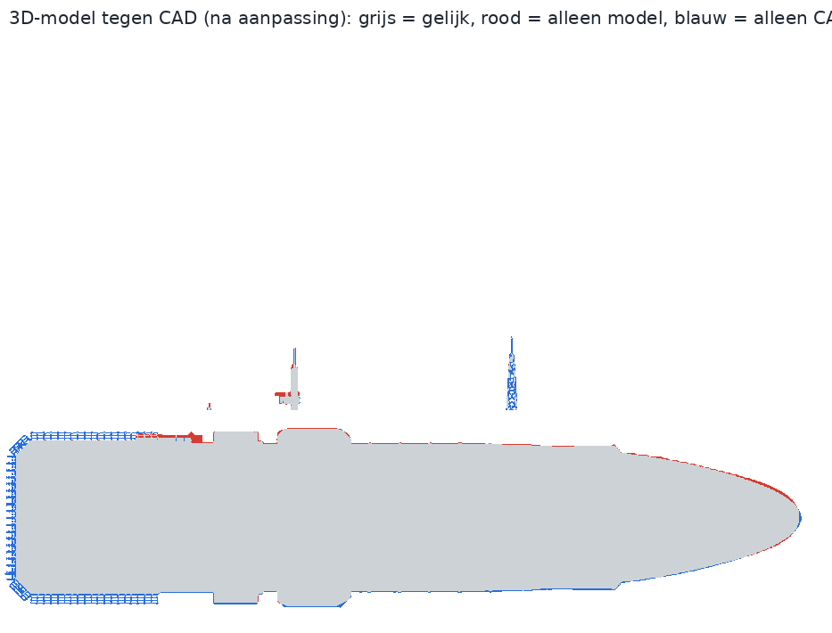
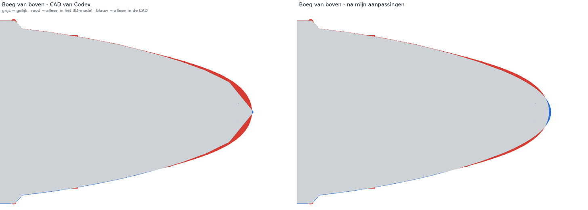
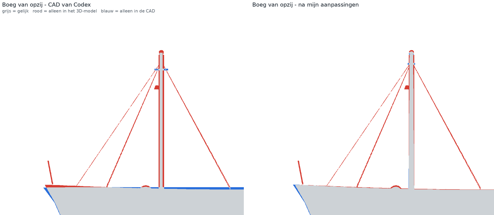
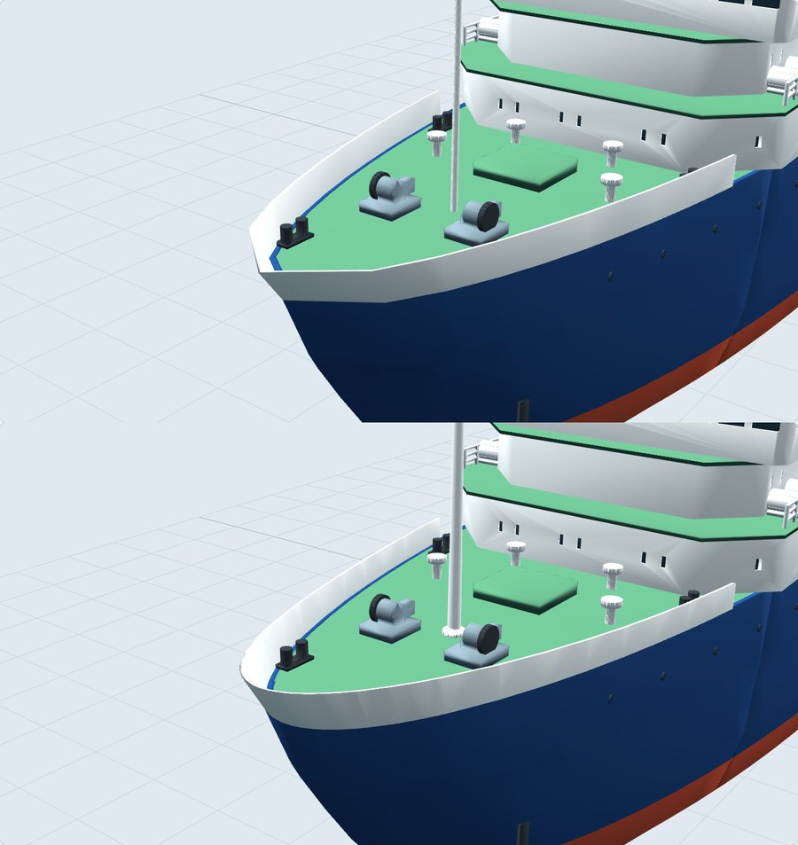
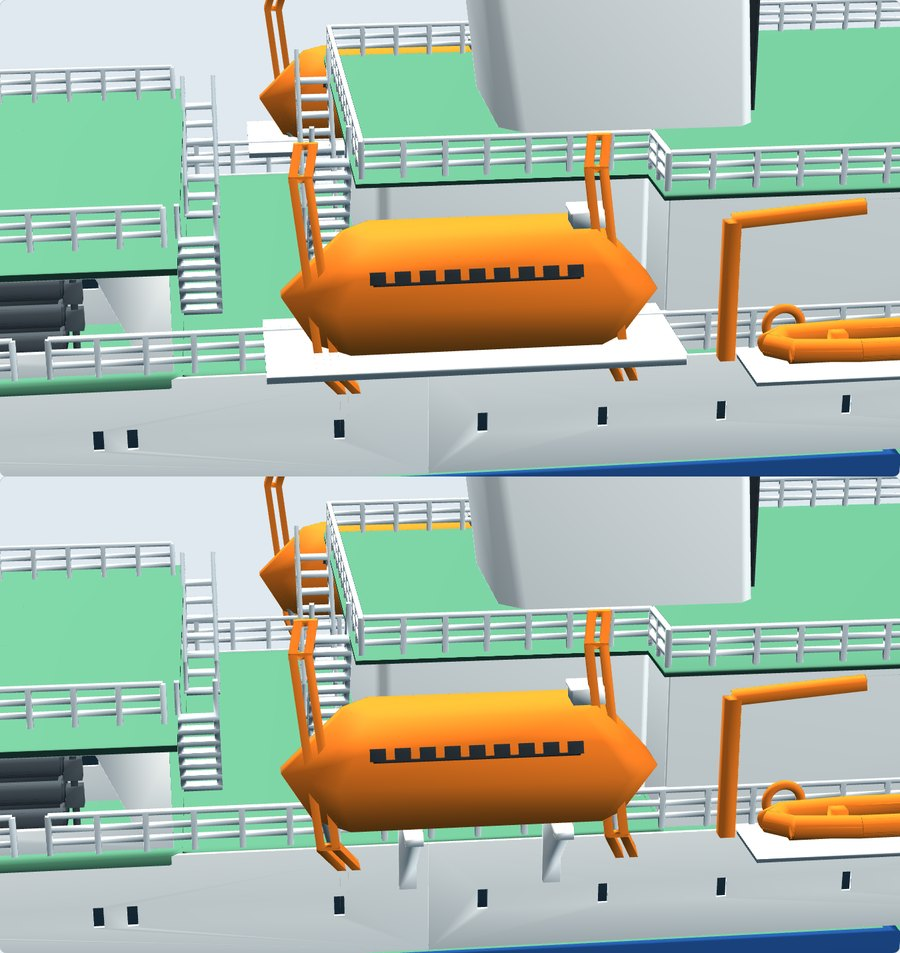
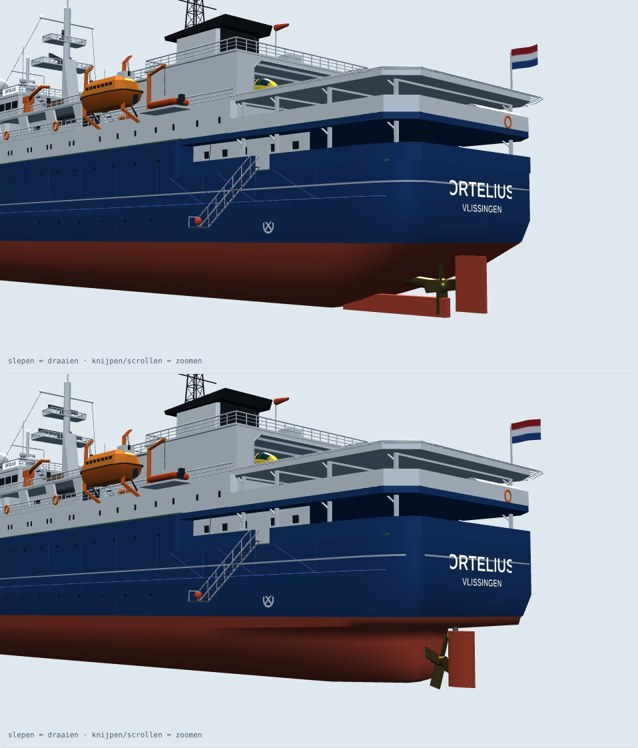
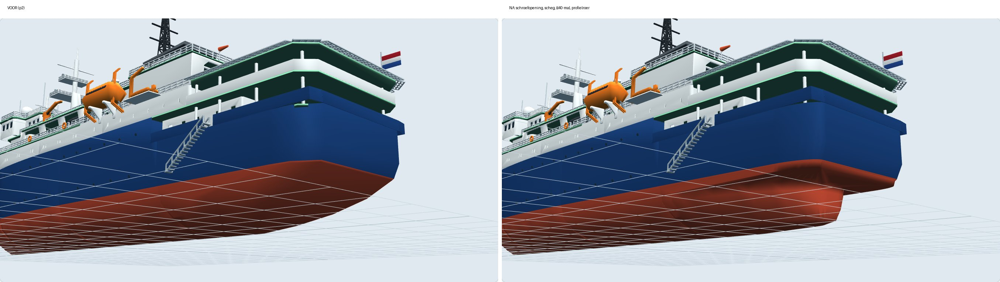

# CAD naast de vormstudie (09-11-2026)

De CAD-assemblage en de vormstudie [`../index.html`](../index.html) zijn vanuit dezelfde
camerastandpunten als silhouet gerenderd en over elkaar gelegd. Grijs is gelijk, rood zit
alleen in de vormstudie, blauw alleen in de CAD.

Romp, dekken, opbouw, schoorsteen, masten, helidek en hangar vallen binnen circa 1 mm samen.
De verschillen die overbleven:

| Verschil | Oorzaak | Aanpak |
|---|---|---|
| Boeg was een wig van circa 26 mm lang en 62 mm breed | Rompcontour met gelijke stappen in X; te grof bij de steven | Fijnere, sinusvormige verdeling in de laatste twee vakken (`bow_tip_samples`) |
| Verschansing vlak 13,5 mm | Zeeg uit de vormstudie ontbrak | 11 mm tot X=740, oplopend naar 15,5 mm |
| Voormast Ø2,6 mm, ra in de lengterichting | Vereenvoudigd voor de printstand | Taps Ø5,2 naar Ø3,2, ra dwarsscheeps, toplicht, kraag en voet |
| Grote dome, GPS en antennes aan de verkeerde zijde | Z van de vormstudie is stuurboord, Y van de CAD is bakboord | Y-teken omgedraaid |
| 4 mm kier boven de achterkajuit | Wand 25 hoog onder een dek op 29 | Wand 29 hoog |
| Wit platform onder de sloepen, zwevend en door de reling | Printhulp die niet in de vormstudie staat | Twee consoles per sloep tegen de wand |

Bewust niet aangepast: stagen en vlaggenstok voorop (garen en draad), de draaiende radarbalken
(stand verschilt per moment) en de iets kleinere vlag.

## Opgelost 10-11-2026: schroef onder het achterschip

In p2 liet de romp bij de schroefnaaf maar een straal van 14,5 mm vrij, dus hooguit een
schroef van Ø29 mm, en het roerblad zat waar de schroef had moeten draaien. Het achterschip
is daarom opnieuw getekend (`stern` in `parameters.json`):

- Onder de toonbank (z 44–47 mm) loopt de romp uit in een smalle scheg, halve breedte 9 mm,
  die bij x=44 eindigt. Daar komt de stevenbuis naar buiten.
- Schroefnaaf op x=36, z=20,5. Een Ø40-schroef heeft rondom minstens 4,0 mm vrij naar de
  romp en steekt niet onder de kiellijn uit.
- Gebalanceerd hangroer met NACA-profiel (koorde 22, dikte 30 %), voorrand op x=29, koning
  op x=23. Het roer raakt de schroefcirkel niet; `validate.py` controleert dat nu.
- De schroefas stijgt met 5,9° (helling 0,103) naar de motor; de servoplaat schuift naar x=150.
- De buitenkant is vanaf x=212 gelijk aan p2. Daarom zijn alleen `01_romp_1`, `52_servoplaat`,
  `56_roerblad` en de nieuwe schroefmal `57_schroefmal_40` veranderd.

Waterverplaatsing bij de ontwerpwaterlijn (54 mm): 4,571 kg (was 4,628); drukkingspunt op
x=411 mm.

