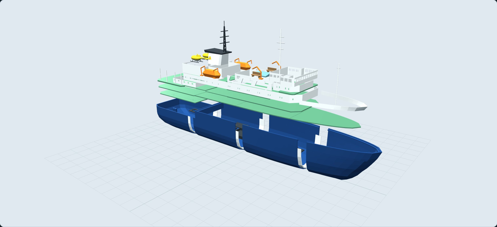

# Ortelius p1 — bouw- en printvolgorde

Dit is het **eerste printbare constructieprototype** op schaal 1:100 voor
het P2S-bouwvolume van 256 × 256 × 256 mm. De vorm volgt de browserstudie v3,
met constructieve vereenvoudigingen voor FDM. Er is nog geen fysieke
pasproef, lekproef of vaartest uitgevoerd. Print eerst de kleine proefstukken.

## Wat je opent

- [`../cad/index.html`](../cad/index.html): de daadwerkelijke CAD-onderdelen, gemonteerd of uit elkaar.
- [`../cad/step/ortelius-p1-assemblage.step`](../cad/step/ortelius-p1-assemblage.step): benoemde CAD-assemblage in millimeters.
- `stl/`: één bestand per uniek onderdeel, al georiënteerd met de onderkant op Z = 0.
- `3mf/`: dezelfde geometrie, expliciete millimetereenheid, op het midden van een 256 mm plaat geplaatst. **Geen machineprofiel of G-code.**
- [`onderdelen.csv`](onderdelen.csv): aantallen, printmaten en aanwijzingen per onderdeel.
- [`onderdelen.json`](onderdelen.json): dezelfde informatie plus montageposities en geometrische massa.
- [`controle.json`](controle.json): hercontrole van STEP/STL/3MF; [`slicercontrole.json`](slicercontrole.json): uitgevoerde slicerproeven.
- [`SHA256SUMS.txt`](SHA256SUMS.txt): checksums van de exports.

De twee JSON-bestanden in `profielen/` zijn eigen procesinstellingen die
erven van het officiële P2S-profiel in Bambu Studio; ze regelen geen
filamenttemperatuur of printerhardware. De slicercontrole gebruikt tijdelijke,
volledig opgeloste officiële printer- en ASA-profielen met Textured PEI Plate.

Alle kopieën zijn identiek: print een bestand zo vaak als de kolom **aantal**
aangeeft. Eén `60_heli_romp_BB` en één `60_heli_romp_SB` vormen één helikopter;
van beide helften zijn er twee nodig. De CSV is de volledige productielijst.
De montageposities in JSON gelden vóór de printrotatie en bedverplaatsing.
De STEP per onderdeel staat net als het STL in **printstand**; de grote
assemblage-STEP staat in scheepscoördinaten.

## Eerst een kleine pasproef

1. Print `00_pasproef_A`, `00_pasproef_B` en `00_pasproef_las` in het materiaal
   dat je voor de romp wilt gebruiken.
2. Leg A en B met de snijvlakken tegen elkaar. De strip overlapt de naad aan
   de binnenkant; de nominale lijmspeling is 0,25 mm horizontaal/verticaal.
3. Controleer de uitlijning en probeer de epoxyverbinding op de proefdelen.
   Wijzig `fit_clearance` in de CAD-bron als jouw printkrimp dat vraagt.
4. Print daarnaast één deksteun en een helihelft om maat en detail te beoordelen.

## Startinstellingen voor de P2S

Dit zijn **startwaarden voor proefprints**, geen materiaalrecept of
gekalibreerd machineprofiel. Gebruik in Bambu Studio je eigen P2S met
0,4 mm nozzle en het officiële profiel voor jouw filament. De bestaande
materiaalkeuze is ASA voor romp en buitendelen; bevestig temperatuur,
bedhechting en krimp met je eigen filamentprofiel.

| Onderdelen | Laag | Wanden | Vulling | Ondersteuning en stand |
|---|---:|---:|---:|---|
| Romp 01 | 0,20 mm | 6 | 15% | Aangeleverd op vlak snijvlak; inspecteer boomsteunen buiten de romp en gebruik circa 5 mm brim |
| Lasstroken 02 | 0,20 mm | 6 | 100% | Snijvlak op bed; pasproef vóór grote delen |
| Vlakke dekken en montageplaten | 0,20 mm | 4–6 | 15–25% | Onderzijde op bed; doorgaans geen steunen |
| Opbouw en hangar | 0,16–0,20 mm | 4 | 15% | Controleer raambruggen en de hangaromlijsting |
| Mast, davits, kranen | 0,16 mm | 4 | 100% | Voorgedraaid; steun bij uitstekende armen controleren |
| Helikopterhelften | 0,16 mm | 4 | 15% | Vlak middenvlak op bed, details naar boven |
| Skids, rotors, relingstroken | 0,16 mm | 4 | 100% | Breekbaar; ondersteun skid-dwarsbalkjes en verwijder steunen voorzichtig |

De grootste delen blijven binnen 246 mm per as, met ten minste 5 mm
nominale marge tot de bouwvolumerand. Controleer in de slicer daarnaast
**brim, support, eventuele kalibratiezone en plaatindeling**. Print de grote
rompdelen afzonderlijk. Er is geen automatische AMS-kleurtoewijzing: de
onderdelen zijn per kleur te printen; ramen, scheepsnaam, waterlijn en
helidekmarkeringen schilderen of als eigen decal aanbrengen.

De uitgevoerde proefslicing met deze startprofielen schat de **volledige
printlijst van 146 exemplaren** op circa **2,77 kg ASA en 114 uur**. Dat
is inclusief de berekende steunen/brims, proefstukken en voorraadstroken,
met één exemplaar per plaat; samen indelen kan tijd besparen. Werkelijke
extrusie, mislukkingen en filamentkalibratie kunnen hiervan afwijken.

## Romp en toegang

1. Leg de vier rompdelen in volgorde 1 → 4 (achter → voor) op een rechte
   montagebasis. De naden liggen op X = 227,5 / 455 / 682,5 mm.
2. De drie passende lasstroken overlappen iedere naad 12 mm naar beide kanten.
   Verlijm met geschikte epoxy volgens de lijmfabrikant; druk de strip
   tegen uitlijnblokjes, niet tegen de buitenhuid zodat de speling verdwijnt.
3. Versterk de naden aan de binnenkant met epoxy/glasband. Werk het hele
   natte rompinterieur waterdicht af, inclusief eventuele poriën.
4. Pas eerst de techniek en kabelroutes in; verlijm daarna pas het vaste
   achterste werkdek. Het losse serviceluik van 149,5 × 125,5 mm geeft
   toegang tot servo en as. Borg het met vier M3-bouten en eigen moeren,
   met dunne afdichtingsband op de onderliggende oplegring. Houd de
   achterkajuit en bovenliggende achterdekken demontabel om erbij te komen.
5. De drie voorste hoofddekpanelen rusten op een integrale binnenlip.
   Gebruik de losse M3-deksteunen en eigen M3-bouten/moeren voor borging;
   boor de dekpanelen pas na het uitlijnen. Verlijm steunen aan de romp en
   houd lijm vrij van de afneembare panelen. Schuimband op de oplegging
   beperkt spatwater; het is geen onderwaterafdichting.
6. Verbind de drie voorste hoofddekpanelen met de acht losse deklijmstrips:
   vier per naad aan de onderzijde, ruim binnen de romplip. Werk deze naden
   dicht. Bouw accommodatie en galerijen op deze gezamenlijke drager.
   De complete vooropbouw kan daarna als één unit omhoog; de onderverdeling
   in printpanelen is geen verplicht aantal serviceluiken. Pas dit zonder
   lijm en controleer de bereikbaarheid voordat je de bovenbouw vastzet.

De romp heeft een horizontale binnenoffset **én** een verticale bodemoffset
van 3 mm. Daardoor worden de schuine kimmen niet onbedoeld dunne vliezen.
Dit is geen constant-normalen shell: plaatselijk is de wand dikker dan 3 mm.
De lasstroken eindigen onder het achterste werkdek. De 16 montageblokken
zijn bewust los zodat de uiteindelijke borgpunten op bereikbare plekken komen.

## Bovenbouw en aankleding

Print en pas eerst de dekken, accommodatiepanelen, hangar en brug. De ramen
zijn echte gaten; schilder de dagkanten donker en lijm desgewenst dunne
transparante folie binnenin. De hangarwanden en het dak zijn aparte delen,
zodat je de binnenkant kunt schilderen en de helikopters plaatsen.

De schoorsteen is hol. De zwarte kap en de mast zijn losse delen. De
vakwerkmast is als **vlakke, versterkte plaat** uitgevoerd; lijm de drie
losse ra’s eraan. De andere masten en davits zijn verdikt voor FDM.
De 24 relingstroken van 100 mm zijn losse voorraadstukken om bij de
proefmontage in te korten; niet allemaal onverkort op het schip lijmen.
Messing draad kan geprinte relingen en antennes vervangen.

Sloepen, platforms, davits, kranen, banken en lichtkap zijn losse kleuronderdelen.
Kleine fotodetails zoals touwen, dunne antennes, veiligheidsnetten, zodiacs,
ankerkettingen en tekst zijn geen losse printdelen in p1; voeg die met
modelbouwmateriaal toe. De fotoverhoudingen zijn aangehouden, maar deze
CAD-versie is geen één-op-één export van ieder visueel browserdetail.

## Twee helikopters

1. Verlijm de twee gele romphelften vlak op elkaar; beide heli's zijn gelijk.
2. Schilder de cockpitramen naar het voorbeeld in [`../index.html`](../index.html).
3. Pas het aparte landingsgestel en verlijm de dwarsstukken aan de onderzijde.
4. Per heli zijn er drie losse hoofdrotorbladen, onder 120° op de naaf.
   Voor de hangar laat je ze **los** en berg je ze apart op. Er is geen
   vouwmechanisme; alle blad- en staartrotorverbindingen zijn lijmverbindingen.
5. Plaats de staartrotor aan de zijkant van de staart. Deze kan in de hangar
   aan de binnenzijde worden gedraaid of apart gelegd voor meer vrije ruimte.

De heliromp is 109,3 mm lang en de stabilisator is 25,3 mm breed. Zonder
hoofdrotorbladen blijft de naaf circa 2 mm onder de bovenzijde van de
modelingang. Twee heli's passen naast elkaar bij X = 213, Y = ±32 mm.
Dit is een statische modelpassing, geen bewijs van de werkelijke hangarmaten.

## RC-techniek en doorvoeren

De geprinte delen zijn **houders**, geen functionele motoren, accu's,
regelaars, schroefassen of boegschroef. De motorplaat heeft verstelbare
sleuven voor een eigen metalen motorbeugel. De accubak heeft ruimte voor
de eerder getoonde 140 × 48 × 28 mm accu en klittenband. Servo- en
regelaarplaten zijn voorlopige adapters; controleer je daadwerkelijke hardware.

De romp is bewust **dicht bij as, roerkoker en boegschroef**. Kies eerst de
stevenbuis, metalen as, koppeling, roerkoker, lagers en boegschroef, pas daarna
de gaten en montages aan in de CAD-bron. Lijm kokers waterdicht in, zorg voor
bereikbare afdichtingen en controleer de uitlijning met de echte motorbeugel.
`55_boegschroef_proeftunnel` is alleen een maattest van ID20/OD23 mm, geen
werkende thruster. De roerbladbron heeft een gat voor een metalen Ø4 mm as
met circa 0,2 mm diameterspeling. Gebruik voor het functionele roersysteem
handelslagers, hevel en afdichting; druk geen as of lager uit ASA.

De digitale controle toetst de houders tegen de romp. Bevestigingsschroeven,
kabels, motorbeugel, koelruimte en bereikbaarheid vragen daarna een inbouwproef.

## Gewicht, water en proefvaren

`onderdelen.json` bevat een **geometrische massabovengrens bij volledig
solide ASA** voor de hele printlijst, inclusief voorraadstroken en proefstukken.
De slicer berekent de werkelijke extrusiemassa met jouw instellingen.
Hydrostatica bij drie waterlijnen volgt uit de geschatte buitenromp; dit is
geen bewijs dat het echte schip dezelfde onderwatervorm heeft.

Weeg alle geprinte delen, RC-hardware en lijm. Ballast laag en verschuifbaar;
bepaal de gewenste waterlijn en het zwaartepunt door een drijfproef. Begin
met een lege romp en een lekproef, daarna droog gemonteerde techniek,
dan een drijfproef zonder aangedreven schroef en pas daarna rustig proefvaren.
Voeg de accu pas toe als binnenkant en alle doorvoeren droog blijven.
