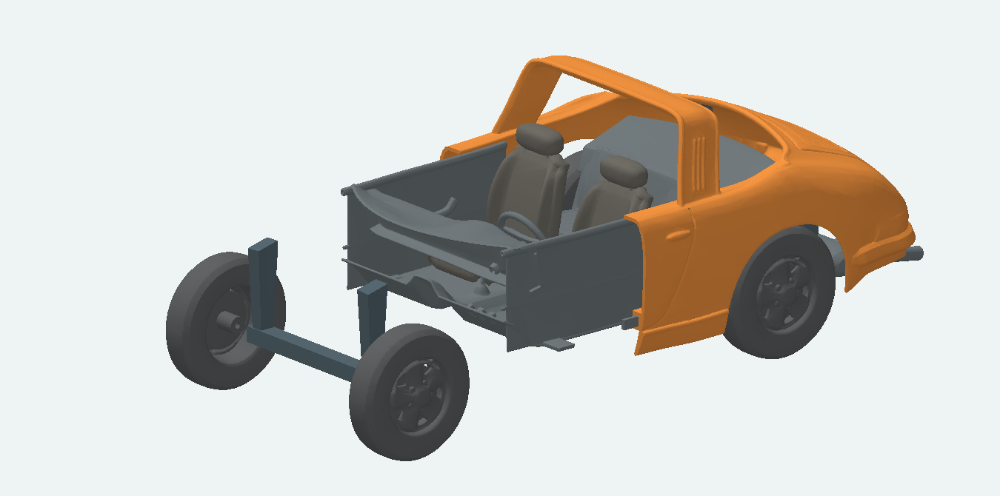

# 911 Targa 1971 · printprototype v7 op schaal 1:10

**Begin met twee pasblokken en één pasveer.** Open de 3MF-bestanden in Bambu Studio, kies de P2S met een nozzle van 0,4 mm en behoud de opgeslagen oriëntatie. Schuif de pasveer in beide blokken. De blokken moeten elkaar raken en de verbinding moet met de hand weer los kunnen. Bewaar de veer voor de auto. [Pasblok](3mf/00-pasblok.3mf) · [Pasveer](3mf/01-pasveer.3mf)

De auto is circa 407 mm lang. De kap is in twee stukken verdeeld en is open aan de onderkant. De buitenhuid heeft een nominale wand van 1,92 mm. Bij naden, omgezette randen en accessoires varieert die maat. Elke rij in de tabel is één uniek bestand. De aantallen voor het complete model staan in de tweede kolom.

## Bestanden

| Onderdeel | Aantal | Plaat voor Bambu Studio | STL in mm | CAD in montagepositie |
| --- | ---: | --- | --- | --- |
| Pasblok voor de proef | 2 | [3MF](3mf/00-pasblok.3mf) | [STL](stl/00-pasblok.stl) | [STEP](../cad/step/00-pasblok.step) |
| Pasveer voor de dorpel | 2 | [3MF](3mf/01-pasveer.3mf) | [STL](stl/01-pasveer.stl) | [STEP](../cad/step/01-pasveer.step) |
| Voorste carrosseriehelft | 1 | [3MF](3mf/02-carrosserie-voor-v7.3mf) | [STL](stl/02-carrosserie-voor-v7.stl) | [STEP](../cad/step/02-carrosserie-voor-v7.step) |
| Achterste carrosseriehelft | 1 | [3MF](3mf/03-carrosserie-achter.3mf) | [STL](stl/03-carrosserie-achter.stl) | [STEP](../cad/step/03-carrosserie-achter.step) |
| Interieurbak met dashboard en stuur | 1 | [3MF](3mf/04-interieurbak.3mf) | [STL](stl/04-interieurbak.stl) | [STEP](../cad/step/04-interieurbak.step) |
| Bestuurdersstoel | 1 | [3MF](3mf/05-voorstoel-links.3mf) | [STL](stl/05-voorstoel-links.stl) | [STEP](../cad/step/05-voorstoel-links.step) |
| Passagiersstoel | 1 | [3MF](3mf/05-voorstoel-rechts.3mf) | [STL](stl/05-voorstoel-rechts.stl) | [STEP](../cad/step/05-voorstoel-rechts.step) |
| Uitneembaar Targa-dak | 1 | [3MF](3mf/06-targadak.3mf) | [STL](stl/06-targadak.stl) | [STEP](../cad/step/06-targadak.step) |
| Voorruit | 1 | [3MF](3mf/07-voorruit-v7.3mf) | [STL](stl/07-voorruit-v7.stl) | [STEP](../cad/step/07-voorruit-v7.step) |
| Achterruit | 1 | [3MF](3mf/07-achterruit.3mf) | [STL](stl/07-achterruit.stl) | [STEP](../cad/step/07-achterruit.step) |
| Linker tochtruit | 1 | [3MF](3mf/07-tochtruit-links.3mf) | [STL](stl/07-tochtruit-links.stl) | [STEP](../cad/step/07-tochtruit-links.step) |
| Rechter tochtruit | 1 | [3MF](3mf/07-tochtruit-rechts.3mf) | [STL](stl/07-tochtruit-rechts.stl) | [STEP](../cad/step/07-tochtruit-rechts.step) |
| Binnenspiegel | 1 | [3MF](3mf/08-binnenspiegel.3mf) | [STL](stl/08-binnenspiegel.stl) | [STEP](../cad/step/08-binnenspiegel.step) |
| Fuchs-voorwiel met sierband | 2 | [3MF](3mf/09-fuchs-voor.3mf) | [STL](stl/09-fuchs-voor.stl) | [STEP](../cad/step/09-fuchs-voor.step) |
| Fuchs-achterwiel met sierband | 2 | [3MF](3mf/09-fuchs-achter.3mf) | [STL](stl/09-fuchs-achter.stl) | [STEP](../cad/step/09-fuchs-achter.step) |
| Uitlaat met demper en steunen | 1 | [3MF](3mf/10-uitlaat.3mf) | [STL](stl/10-uitlaat.stl) | [STEP](../cad/step/10-uitlaat.step) |
| Voorste asdrager voor het vitrinemodel | 1 | [3MF](3mf/11-asdrager-voor.3mf) | [STL](stl/11-asdrager-voor.stl) | [STEP](../cad/step/11-asdrager-voor.step) |
| Achterste asdrager voor het vitrinemodel | 1 | [3MF](3mf/11-asdrager-achter.3mf) | [STL](stl/11-asdrager-achter.stl) | [STEP](../cad/step/11-asdrager-achter.step) |
| Ruitenwisser links | 1 | [3MF](3mf/12-wisser-links-v7.3mf) | [STL](stl/12-wisser-links-v7.stl) | [STEP](../cad/step/12-wisser-links-v7.step) |
| Ruitenwisser rechts | 1 | [3MF](3mf/12-wisser-rechts-v7.3mf) | [STL](stl/12-wisser-rechts-v7.stl) | [STEP](../cad/step/12-wisser-rechts-v7.step) |

[Complete STEP-assemblage](../cad/step/targa-v7-assemblage.step) · [Onderdelenlijst met plaatmaten](onderdelen.csv) · [Bewerkbare bouwbron](../cad/printbouw/README.md)

## Printen en monteren

1. **Pasproef.** De veer is 17 × 5 × 2 mm. De sleuf is 5,5 × 2,5 mm en 9 mm diep in elke helft. Verwijder brim en olifantenvoet vóór het passen. Controleer de proef op dezelfde printer, met hetzelfde filament en profiel als de carrosserie.
2. **Carrosserie.** Print beide helften met het deelvlak op het bed. De neus en de staart wijzen omhoog. Houd ondersteuning onder de bumpers, spiegel, raamstijlen en overhangen toegankelijk. Maak de sleuven vrij. Schuif de twee veren eerst droog in de dorpels en controleer aan beide kanten de deurlijn. Lijm pas na de controle op het chassis.
3. **Interieur.** Lijm de twee stoelen met de rails op de vloer, naast de middentunnel. Schuif de complete bak van onderen op zijn plaats en pas de vier lijmoren tegen de binnenwand. Controleer eerst of de bak vanaf de onderzijde kan worden geplaatst en of de accu bereikbaar blijft. De uitlaat heeft twee lijmsteunen tegen de binnenkant van de achterwand. Pas de uitlaat vóór het sluiten van de carrosserie.
4. **Ruiten en dak.** Pas de ruiten van binnenuit. Lijm de binnenspiegel tegen de bovenzijde van de voorruit. Gebruik spaarzaam lijm die geschikt is voor helder kunststof. De geprinte ruiten zijn ook bruikbaar als vormreferentie voor heldere kunststof inzetstukken. Transparant FDM-filament geeft zichtbare laaglijnen. Het losse dak rust op de voorruitlijst en de Targabeugel.
5. **Vitrinemodel.** Gebruik de twee meegeleverde asdragers. De korte drager zit voor, de drager met de lange armen achter. De bovenzijden volgen de binnenkant van de kleppen. Pas ze met de vier wielen gecentreerd in de wielkasten en lijm ze daarna vast. Schuif een gladde metalen as van Ø 3 mm door iedere drager. Begin met circa 134 mm aslengte, pas droog en kort waar nodig in. De naven hebben een blind gat van Ø 3,2 mm. Werk de vijf spaakbladen en de buitenste velgrand desgewenst zilver af.
6. **RC op het M-06M-chassis.** Gebruik de kitassen en kitwielen. Laat beide vitrinedragers en de vier sierwielen uit de kap. Stel de kit in op 225 mm wielbasis en centreer de kap met haar wielbasis van 226,8 mm. Pas eerst de lege kap en daarna het interieur en de uitlaat. Controleer de voorwielen bij maximale stuuruitslag en ingeveerde ophanging. Teken de bodypennen af op de echte kit en bepaal dan de gaten en montagehoogte.

De voorste carrosseriehelft, ruiten en het dak zijn hier weggenomen. De twee staanders boven de vooras sluiten aan tegen de binnenkant van de neus. Aan de zijkant is de pasveer zichtbaar die de twee carrosseriehelften uitlijnt.

## Losse ruitenwissers monteren

Print één linker- en één rechterwisser en verwijder de ondersteuning voorzichtig. Plaats de voorruit eerst. Kijk in de rijrichting om links en rechts te bepalen. In de voorste carrosseriehelft v7 zitten onder de voorruit twee ronde uitsparingen van Ø 2,6 mm voor de pennetjes van Ø 2,1 mm. Pas elk pennetje droog in de bijbehorende uitsparing en richt beide bladen naar de bestuurderskant. Zet alleen het voetje met een klein druppeltje kunststoflijm vast. Houd de lijm weg van de ruit en laat hem uitharden voordat je de kap oppakt.

## Printer en controles

Bambu Studio schat het complete vitrinemodel op **754 g PLA en 44.1 uur** inclusief ondersteuning. De voorste carrosseriehelft vraagt circa 184 g en 8 uur 15 minuten. De achterste vraagt circa 150 g en 6 uur 55 minuten. Voor twee pasblokken en één veer samen is de schatting circa 1,6 g en 35 minuten.

De 3MF-bestanden bevatten maatvaste geometrie en plaatpositie. Importeer het [procesprofiel](profielen/targa-p2s.json) in Bambu Studio om de proefslicing te herhalen met Generic PLA, laaghoogte 0,20 mm, drie wandlijnen, 5 mm brim en automatische boomondersteuning. Gebruik voor de Fuchs-wielen, ruitenwissers en de uitlaat het [profiel voor kleine overhangen](profielen/targa-kleine-overhangen-p2s.json). Dit ondersteunt de terugliggende spaken en de uitlaatrand met aansluitende normale ondersteuning. De onderdelen worden afzonderlijk gesliced. Bekijk de ondersteuning in de laagweergave voordat je een grote helft start.

De [geometriecontrole](controle.json) hoort bij de geleverde STL-, 3MF- en STEP-bestanden. De [slicercontrole](slicercontrole.json) geeft per onderdeel het geschatte verbruik inclusief ondersteuning en de printtijd. De berekening gebruikt één materiaal per printplaat. De bouwbron bevat de printmaten en de stappen om opnieuw te exporteren. De passing op de P2S en op de gekochte M-06M is nog niet fysiek getest.
